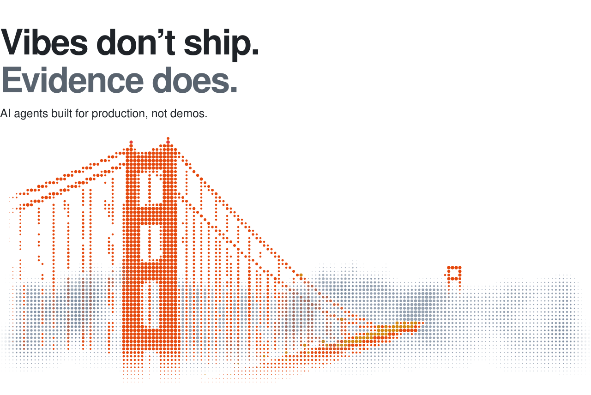
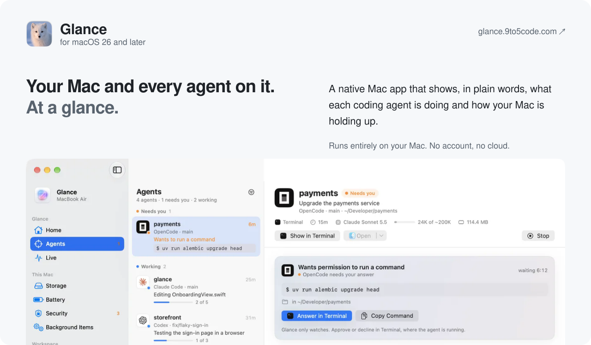
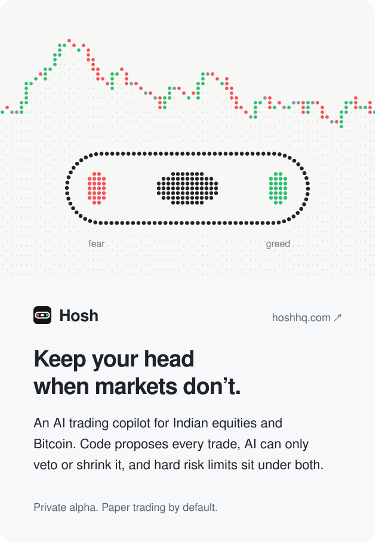
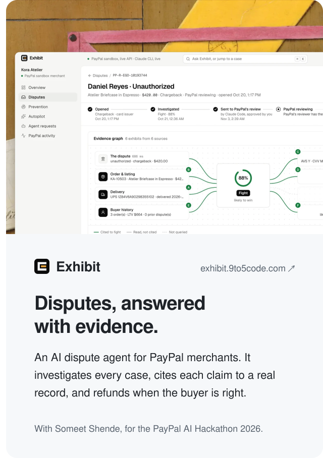
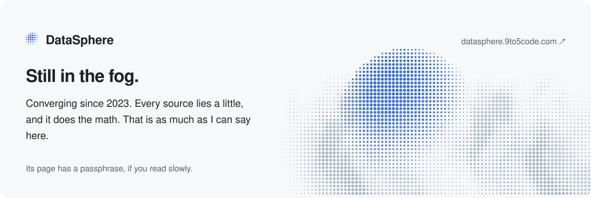
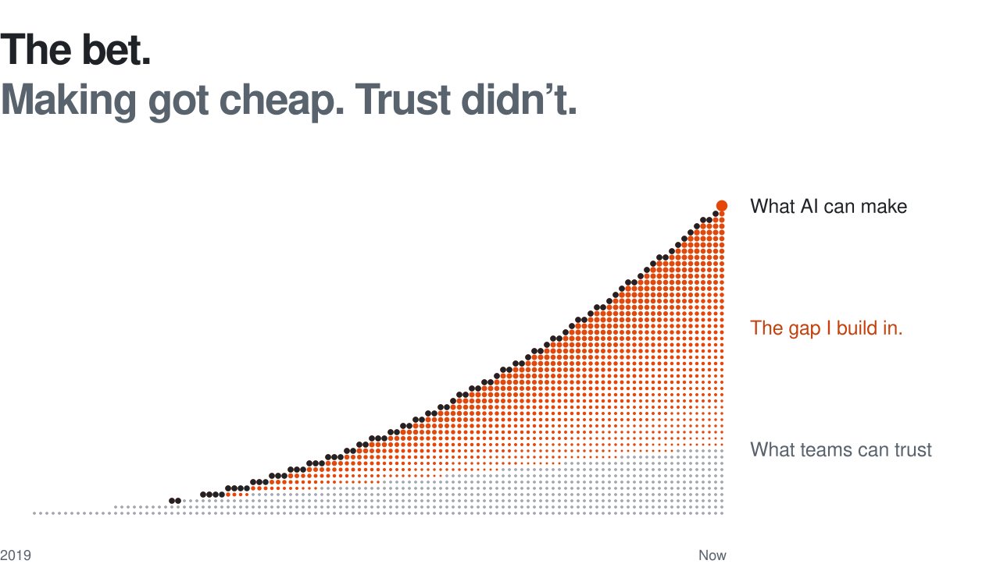

<!--
  Reading the source? Good instinct.
  Every image here is generated by scripts/build.py, so you can check the work too.
  The bridge is drawn after "Golden Fog, San Francisco" by runner310, CC BY 2.0.
  Full credits: scripts/source/CREDITS.md
-->

<picture>
  <source media="(prefers-color-scheme: dark)" srcset="assets/dark/hero.svg">
  
</picture>

**I build AI that enterprises can trust.** It does the work, shows its reasoning, and keeps people in control.

<a href="https://extratunnel.ai"><picture><source media="(prefers-color-scheme: dark)" srcset="assets/dark/link-extratunnel.svg"></picture></a><a
  href="https://kadeep.ai"><picture><source media="(prefers-color-scheme: dark)" srcset="assets/dark/link-kadeep.svg"></picture></a><a
  href="https://9to5code.com"><picture><source media="(prefers-color-scheme: dark)" srcset="assets/dark/link-9to5code.svg"></picture></a><a
  href="https://x.com/shvuuuu"><picture><source media="(prefers-color-scheme: dark)" srcset="assets/dark/link-x.svg"></picture></a><a
  href="https://www.linkedin.com/in/dwivedishivansh"><picture><source media="(prefers-color-scheme: dark)" srcset="assets/dark/link-linkedin.svg"></picture></a>

 

<picture>
  <source media="(prefers-color-scheme: dark)" srcset="assets/dark/h-building.svg">
  
</picture>

<a href="https://extratunnel.ai"><picture>
  <source media="(prefers-color-scheme: dark)" srcset="assets/dark/card-extratunnel.svg">
  
</picture></a>

<a href="https://extratunnel.ai/#security-teams"><picture>
  <source media="(prefers-color-scheme: dark)" srcset="assets/dark/card-extratunnel-proof.svg">
  
</picture></a>

<a href="https://kadeep.ai/studio"><picture>
  <source media="(prefers-color-scheme: dark)" srcset="assets/dark/card-kadeep.svg">
  
</picture></a>

<a href="https://glance.9to5code.com"><picture>
  <source media="(prefers-color-scheme: dark)" srcset="assets/dark/card-glance.svg">
  
</picture></a>

<a href="https://hoshhq.com"><picture><source media="(prefers-color-scheme: dark)" srcset="assets/dark/card-hosh.svg"></picture></a><a
  href="https://exhibit.9to5code.com"><picture><source media="(prefers-color-scheme: dark)" srcset="assets/dark/card-exhibit.svg"></picture></a>

<a href="https://datasphere.9to5code.com"><picture>
  <source media="(prefers-color-scheme: dark)" srcset="assets/dark/card-datasphere.svg">
  
</picture></a>

 

<picture>
  <source media="(prefers-color-scheme: dark)" srcset="assets/dark/bet.svg">
  
</picture>

AI can now produce a week of work in an afternoon. Trusting it still takes the week. I build the products that close that gap.

 

<picture>
  <source media="(prefers-color-scheme: dark)" srcset="assets/dark/h-hi.svg">
  
</picture>

That's the job I want to hear about. If you're building, hiring or investing where being wrong is expensive, my DMs are open on [X](https://x.com/shvuuuu), and I'm on [LinkedIn](https://www.linkedin.com/in/dwivedishivansh).

 

<picture>
  <source media="(prefers-color-scheme: dark)" srcset="assets/dark/footer.svg">
  
</picture>
